# RescueLink
## Surplus Food Rescue & Redistribution Network

**Database Management Systems — Final Project Report**

**Student:** `<name surname>` — `<student number>`<br>
**Date:** 24 November 2026<br>
**Database:** PostgreSQL 18.6 (schema targets PostgreSQL 16+)<br>
**Application:** Python 3.11, Flask 3.1, psycopg 3.3, plain HTML/CSS

---

## Abstract

RescueLink is a database-backed coordination platform for surplus food rescue.
Donors publish perishable batches; recipient organisations claim the kilograms
they can actually store; volunteer couriers collect and deliver them under a
recorded cold-chain check. The schema contains **16 tables, five many-to-many
junction tables and two derived views**, populated with **73,645 rows** of
deterministic, referentially honest data. The centrepiece is a **seven-table
ACID transaction** that reserves a batch, records the temperature probe,
assigns a certified courier and vehicle, creates the delivery run and writes an
audit row — all under a `SELECT … FOR UPDATE` row lock, with every failure path
rolled back. Nine analytical queries demonstrate window functions, CTEs,
subqueries and filtered aggregations; fourteen indexes are benchmarked with
`EXPLAIN (ANALYZE, BUFFERS)` before and after, with the busiest application
query improving by **92 %**. A minimal Flask front end (no ORM, all raw SQL
parameterised) exposes the four roles, CRUD, the transaction demo, analytics
and the performance evidence.

---

[TOC]

---

## 1. Introduction

### 1.1 The problem

Food waste and food insecurity coexist within a few kilometres of each other.
Commercial kitchens, bakeries, hotels and supermarkets discard edible surplus
because matching it to a food bank is an operational problem, not a storage
problem: surplus is perishable, recipients differ in what they can refrigerate,
and a handover that happens after the expiry hour is worthless. Spreadsheets
and phone chains cannot answer the two questions that matter in time —
*what is still safe, and who can take it right now?*

### 1.2 What the database provides

* **A single source of truth for availability.** Remaining kilograms are
  derived from the allocation ledger, never cached, so two coordinators can
  never promise the same food twice.
* **Capability-aware matching.** A recipient is only offered categories listed
  in `org_capabilities` and only up to its declared weekly capacity.
* **Cold-chain traceability.** Every pickup has a temperature probe, a pass/fail
  result and the user who took it.
* **Certified logistics.** A courier can only drive if a valid C1 licence
  exists in `volunteer_skills`; refrigerated cargo requires a refrigerated
  vehicle.
* **Accountability.** Every privileged write appends to `audit_log` with the
  actor taken from the session, not from the form.

### 1.3 Technology stack

| Layer | Choice | Why |
| :--- | :--- | :--- |
| Database | PostgreSQL 18.6 (local cluster, port 5433) | Real ACID semantics, partial and covering indexes, rich `EXPLAIN`, window functions. |
| Backend | Python 3.11 + Flask 3.1 | Minimal, explicit request handling; no magic. |
| Driver | psycopg 3.3 | Native parameter binding, transaction control, `dict_row`. |
| Front end | Jinja-rendered HTML + one CSS file | The brief asks for plain HTML, not a SPA. |
| ORM | **None** | Hard requirement: parameterised raw SQL only. |
| Data generation | Python `random.Random(20261210)` | Reproducible 73,645-row dataset. |

---

## 2. Database design

### 2.1 Design principles

1. **One fact, one place.** A donor's name lives in `organizations`, a
   category's refrigeration rule lives in `food_categories`; batches reference
   them by foreign key rather than copying them.
2. **Events are first-class.** A claim (`batch_allocations`), a probe
   (`cold_chain_checks`), a receipt (`handovers`) and a trip (`delivery_runs`)
   are rows with their own identity and timestamp — not nullable columns
   stuffed into `donation_batches`.
3. **Derive, do not cache.** Remaining quantity, run batch counts and crew size
   are computed in views.
4. **Constraints do the policing.** Expiry order, positive quantities,
   enumeration values, licence date order and "partner staff must belong to an
   organisation" are all enforced by the database, so the API cannot bypass
   them.

### 2.2 Entity catalogue

| # | Table | Purpose | Primary key | Main foreign keys | Seeded rows |
|---:|---|---|---|---|---:|
| 1 | `roles` | Four access levels | `role_id` | — | 4 |
| 2 | `organizations` | Donors and recipients, discriminated by `org_type` | `org_id` | — | 40 |
| 3 | `users` | All people, one role each, partners tied to an organisation | `user_id` | `role_id`, `org_id` | 81 |
| 4 | `food_categories` | Taxonomy + refrigeration rule + shelf life | `category_id` | — | 12 |
| 5 | `org_capabilities` | **M:N** recipient ↔ category, with weekly kg cap | `(org_id, category_id)` | `org_id`, `category_id` | 124 |
| 6 | `donation_batches` | Perishable inventory | `batch_id` | `donor_org_id`, `category_id`, `created_by` | 12,000 |
| 7 | `batch_allocations` | **M:N** batch ↔ recipient claim | `allocation_id` (+ unique pair) | `batch_id`, `recipient_org_id` | 15,396 |
| 8 | `cold_chain_checks` | Temperature probes | `check_id` | `batch_id`, `checked_by` | 21,733 |
| 9 | `handovers` | Signed receipt per allocation | `handover_id` (+ unique allocation) | `allocation_id` | 15,337 |
| 10 | `vehicles` | Fleet and refrigeration capability | `vehicle_id` | `owner_org_id` | 24 |
| 11 | `delivery_runs` | One trip | `run_id` | `vehicle_id`, `lead_user_id` | 1,200 |
| 12 | `run_batches` | **M:N** run ↔ batch pickup list | `(run_id, batch_id)` | `run_id`, `batch_id` | 3,593 |
| 13 | `shift_assignments` | **M:N** run ↔ volunteer crew | `(run_id, user_id)` | `run_id`, `user_id` | 2,463 |
| 14 | `skills` | Certification catalogue | `skill_id` | — | 6 |
| 15 | `volunteer_skills` | **M:N** volunteer ↔ certification | `(user_id, skill_id)` | `user_id`, `skill_id` | 132 |
| 16 | `audit_log` | Append-only privileged-write trail | `audit_id` | `actor_user_id` | 1,500 |

Two views are added on top: `v_batch_availability` and `v_run_summary`.
**Total seeded rows: 73,645**, including 1,500 audit rows.

### 2.3 Relationship model

* One **role** has many **users**; one **organisation** has many **users**.
* One **donor organisation** publishes many **batches**; one **category**
  classifies many batches.
* **Batches ↔ recipients** is many-to-many, resolved by `batch_allocations`
  with the claimed kilograms as relationship attribute.
* **Runs ↔ batches** and **runs ↔ users** are many-to-many, resolved by
  `run_batches` (with pickup sequence) and `shift_assignments` (with crew role
  and hours).
* **Volunteers ↔ skills** is many-to-many, resolved by `volunteer_skills` with
  certification and expiry dates.
* **Recipients ↔ categories** is many-to-many, resolved by `org_capabilities`
  with the weekly kg limit.
* One **allocation** has at most one **handover** (enforced by a `UNIQUE`
  constraint), and one **batch** has many **cold-chain checks** over time.

### 2.4 Many-to-many evidence

Five junction tables use composite primary keys (or a surrogate key plus a
uniqueness constraint), and each carries attributes that belong to the
relationship rather than to either entity:

```sql
-- M:N #1: a recipient accepts a category, up to N kg per week
CREATE TABLE org_capabilities (
    org_id        integer  NOT NULL REFERENCES organizations (org_id) ON DELETE CASCADE,
    category_id   smallint NOT NULL REFERENCES food_categories (category_id) ON DELETE CASCADE,
    max_weekly_kg numeric(8,2) NOT NULL CHECK (max_weekly_kg > 0),
    PRIMARY KEY (org_id, category_id)
);

-- M:N #2: a batch can feed several recipients, a recipient can claim many batches
CREATE TABLE batch_allocations (
    allocation_id    integer GENERATED ALWAYS AS IDENTITY PRIMARY KEY,
    batch_id         integer  NOT NULL REFERENCES donation_batches (batch_id) ON DELETE CASCADE,
    recipient_org_id integer  NOT NULL REFERENCES organizations (org_id),
    allocated_kg     numeric(8,2) NOT NULL CHECK (allocated_kg > 0),
    status           text NOT NULL DEFAULT 'reserved'
                     CHECK (status IN ('reserved','handed_over','cancelled')),
    allocated_at     timestamptz NOT NULL DEFAULT now(),
    note             text,
    CONSTRAINT allocation_unique_per_recipient UNIQUE (batch_id, recipient_org_id)
);

-- M:N #3: ordered pickup list for a run
CREATE TABLE run_batches (
    run_id      integer NOT NULL REFERENCES delivery_runs (run_id) ON DELETE CASCADE,
    batch_id    integer NOT NULL REFERENCES donation_batches (batch_id),
    sequence_no smallint NOT NULL CHECK (sequence_no > 0),
    PRIMARY KEY (run_id, batch_id),
    CONSTRAINT run_sequence_unique UNIQUE (run_id, sequence_no)
);

-- M:N #4: crew on a run
CREATE TABLE shift_assignments (
    run_id       integer NOT NULL REFERENCES delivery_runs (run_id) ON DELETE CASCADE,
    user_id      integer NOT NULL REFERENCES users (user_id),
    role_on_run  text NOT NULL CHECK (role_on_run IN ('driver','loader','coordinator')),
    hours_logged numeric(4,1) NOT NULL DEFAULT 0 CHECK (hours_logged BETWEEN 0 AND 24),
    PRIMARY KEY (run_id, user_id)
);

-- M:N #5: certifications held by a volunteer
CREATE TABLE volunteer_skills (
    user_id      integer  NOT NULL REFERENCES users (user_id) ON DELETE CASCADE,
    skill_id     smallint NOT NULL REFERENCES skills (skill_id) ON DELETE CASCADE,
    certified_on date NOT NULL,
    expires_on   date NOT NULL,
    PRIMARY KEY (user_id, skill_id),
    CONSTRAINT cert_dates_order CHECK (expires_on > certified_on)
);
```

`batch_allocations` illustrates why a surrogate key is useful even when a
natural pair exists: it is referenced by `handovers` and by the audit trail,
so a stable `allocation_id` keeps those references narrow, while the
`UNIQUE (batch_id, recipient_org_id)` constraint still guarantees the M:N
pair cannot be duplicated.

### 2.5 Integrity constraints

| Kind | Examples |
| :--- | :--- |
| Primary keys | Surrogate identities for entities; composite keys for junctions. |
| Foreign keys | 22 FK references; `ON DELETE CASCADE` only where the child is meaningless without the parent (allocations of a deleted batch, capabilities of a deleted organisation). |
| Uniqueness | `organizations.tax_id`, `users.email`, `vehicles.plate`, one handover per allocation, one crew row per run/user. |
| Domain checks | `org_type IN ('donor','recipient')`, batch status enumeration, allocation status, run status, handover condition, positive kg, 0–24 logged hours, `total_km >= 0`. |
| Temporal checks | `expires_at > prepared_at` on batches; `completed_at >= started_at` on runs; `expires_on > certified_on` on certifications. |
| Conditional check | Partner staff must have an organisation: `CHECK ((role_id = 1) OR (org_id IS NOT NULL))`. |

The application repeats the friendly version of these rules (flash messages),
but the database is the final authority. The transaction demo deliberately
violates a check constraint at its last step to prove that the whole unit of
work disappears.

### 2.6 Derived views

```sql
CREATE VIEW v_batch_availability AS
SELECT b.batch_id, b.donor_org_id, d.name AS donor_name,
       b.category_id, c.name AS category_name, c.needs_refrigeration,
       b.item_description, b.quantity_kg,
       COALESCE(SUM(a.allocated_kg)
                FILTER (WHERE a.status <> 'cancelled'), 0)::numeric(8,2)
                          AS allocated_kg,
       (b.quantity_kg - COALESCE(SUM(a.allocated_kg)
                FILTER (WHERE a.status <> 'cancelled'), 0))::numeric(8,2)
                          AS remaining_kg,
       b.prepared_at, b.expires_at, b.storage_temp_c, b.status, b.created_at
FROM donation_batches b
JOIN organizations   d ON d.org_id = b.donor_org_id
JOIN food_categories c ON c.category_id = b.category_id
LEFT JOIN batch_allocations a ON a.batch_id = b.batch_id
GROUP BY b.batch_id, d.name, c.name, c.needs_refrigeration;
```

`v_run_summary` pre-aggregates batches and crew in separate subqueries before
joining, avoiding the classic fan-out bug where joining two one-to-many
children multiplies the counts.

---

## 3. Normalization

### 3.1 Third normal form test

3NF requires that every non-key attribute depends on the key, the whole key
and nothing but the key. The schema satisfies this by construction:

* Every table's non-key attributes describe **the entity identified by its
  primary key**, not another non-key attribute.
* No table stores a value that is a fact about a different entity. Recurring
  examples that would break 3NF are absent:
  * `donation_batches` does **not** store `donor_name`, `category_name` or
    `needs_refrigeration`; those live in `organizations` / `food_categories`.
  * `users` does **not** store `organisation_name` or `role_name`; those are
    looked up through `org_id` and `role_id`.
  * `shift_assignments` does **not** store the volunteer's name or the run
    date.
* For composite keys, the dependent attribute belongs to the **pair**:
  `org_capabilities.max_weekly_kg` depends on both recipient and category;
  `shift_assignments.hours_logged` depends on both run and user;
  `volunteer_skills.expires_on` depends on both volunteer and skill.

### 3.2 Representative functional dependencies

| Relation | Functional dependencies | Candidate keys |
| :--- | :--- | :--- |
| `users` | `user_id → email, password_hash, full_name, phone, role_id, org_id, is_active, created_at`; `email → user_id` | `user_id`, `email` |
| `donation_batches` | `batch_id → donor_org_id, category_id, item_description, quantity_kg, prepared_at, expires_at, storage_temp_c, status, created_by, created_at` | `batch_id` |
| `batch_allocations` | `allocation_id → batch_id, recipient_org_id, allocated_kg, status, allocated_at, note`; `(batch_id, recipient_org_id) → allocation_id` | `allocation_id`, `(batch_id, recipient_org_id)` |
| `org_capabilities` | `(org_id, category_id) → max_weekly_kg` | `(org_id, category_id)` |
| `run_batches` | `(run_id, batch_id) → sequence_no`; `(run_id, sequence_no) → batch_id` | both pairs |
| `volunteer_skills` | `(user_id, skill_id) → certified_on, expires_on` | `(user_id, skill_id)` |

No non-prime attribute is transitively dependent on a key, so the relations are
in 3NF (and BCNF for the tables whose only determinants are candidate keys).

### 3.3 Denormalization: deliberate decision **not** to denormalize

The most tempting shortcut in this domain is to cache
`donation_batches.remaining_kg` (and perhaps `total_donated_kg` per donor or
`batch_count` per run). We deliberately do **not** store any of them:

* Remaining kg is a fact about the **allocation ledger**, not about the batch.
  Caching it would require every insert, cancellation, handover and soft
  withdrawal to update two places atomically; a single missed path creates
  silent double-booking — the exact failure the platform exists to prevent.
* The derived view keeps the invariant true by construction. The cost is one
  grouped join, measured at roughly 1.8 ms on the at-risk query after indexing.
* The project brief allows denormalization **if documented and justified**.
  Here the justified decision is the opposite: correctness is worth more than
  the microseconds a cached column would save, and the measured plans confirm
  the view is not the bottleneck.

The only deliberately non-relational column is `audit_log.details jsonb`.
Audit payloads differ per action (a dispatch stores batch, kg and run id; a
category creation stores a name), so a fixed set of columns would either be
mostly `NULL` or force a new table per action. JSONB keeps the trail
append-only and queryable (`details->>'kg'`) without pretending it is a
normalized entity. It is not used for any business decision.

### 3.4 Update anomalies avoided

| Anomaly | Without normalization | With this schema |
| :--- | :--- | :--- |
| Insert | Cannot add a category until some batch uses it. | Categories exist independently. |
| Update | Renaming a donor requires editing thousands of batch rows. | One row in `organizations`. |
| Delete | Deleting the last batch of a recipient erases the recipient. | Organisations outlive batches. |

---

## 4. Roles and access control

### 4.1 Four roles

| Role | Purpose |
| :--- | :--- |
| **Platform Admin** | Operates the network: partners, categories, users, vehicles, audit, analytics. |
| **Donor Staff** | Publishes and maintains their organisation's surplus. |
| **Recipient Coordinator** | Claims food and signs handovers for one recipient organisation. |
| **Volunteer Courier** | Sees assigned routes and crew information. |

### 4.2 Route-level matrix

`✓` = allowed, `—` = denied with HTTP 403.

| Resource / action | Admin | Donor Staff | Recipient Coordinator | Volunteer Courier |
|---|:---:|:---:|:---:|:---:|
| Dashboard | ✓ | ✓ | ✓ | ✓ |
| Own-org batch list | ✓ (all) | ✓ (own) | — | — |
| Create batch | — | ✓ | — | — |
| Edit / withdraw batch | ✓ | ✓ (own) | — | — |
| Claimable food (`/claims`) | — | — | ✓ | — |
| Dispatch transaction | ✓ (any recipient) | — | ✓ (own org) | — |
| Sign handover | ✓ | — | ✓ (own org) | — |
| Delivery runs list / detail | ✓ | — | ✓ | ✓ (assigned) |
| Plan run / add pickup / assign crew / complete | ✓ | — | ✓ | — |
| Analytics (9 queries) | ✓ | — | ✓ | — |
| Performance page | ✓ | ✓ | ✓ | ✓ |
| Audit trail | ✓ | — | — | — |
| Admin CRUD (partners, categories, users, vehicles) | ✓ | — | — | — |

### 4.3 Two enforcement layers

Route protection is explicit and deny-by-default:

```python
def roles_required(*roles: str):
    def decorator(view):
        @wraps(view)
        def wrapped(*args, **kwargs):
            if g.user is None:
                return redirect(url_for("login", next=request.path))
            if g.user["role_name"] not in roles:
                flash("Access denied: this action requires "
                      f"{' or '.join(roles)}.", "error")
                return redirect(url_for("dashboard")), 403
            return view(*args, **kwargs)
        return wrapped
    return decorator

@app.route("/admin/users", methods=("GET", "POST"))
@roles_required("Admin")
def admin_users(): ...
```

Route checks alone are not enough: a coordinator could hand-craft another
organisation's id. Every partner query therefore also carries a session-derived
predicate:

```python
# auth.org_scope(): None for Admin, the user's org_id otherwise
rows = db.query("""
    SELECT ...
    FROM batch_allocations a
    JOIN donation_batches b ON b.batch_id = a.batch_id
    WHERE a.recipient_org_id = %s
    ORDER BY a.allocated_at DESC
""", (org,))
```

The actor recorded in `audit_log` always comes from `g.user["user_id"]`, never
from a hidden form field, so the trail cannot be forged by editing HTML.

---

## 5. Data generation

### 5.1 Reproducible seed

`sql/03_seed.py` wipes and repopulates the schema with a fixed RNG seed
(`20261210`). Re-running it produces byte-identical data, which is what makes
the `EXPLAIN` numbers comparable across machines and across reruns.

```bash
python sql/03_seed.py            # wipe + reseed
python sql/03_seed.py --no-wipe  # append (used only for experiments)
```

### 5.2 Volume and realism rules

The generator does not emit independent random rows; it enforces the business
invariants end to end:

* a claim only goes to a recipient whose `org_capabilities` includes the
  batch's category;
* a recipient's rolling weekly intake stays inside `max_weekly_kg`;
* a driver on a run has a valid C1 licence at the run date;
* refrigerated cargo travels only in a refrigerated vehicle;
* handed-over kilograms never exceed allocated kilograms;
* roughly 10 % of batches spoil, and some certifications are expired so the
  licence guard has real negative cases to reject;
* a handful of donors are dormant (> 30 days without a batch), so the retention
  query returns a real row.

| Table | Rows | Table | Rows |
|---|---:|---|---:|
| `donation_batches` | 12,000 | `delivery_runs` | 1,200 |
| `batch_allocations` | 15,396 | `run_batches` | 3,593 |
| `cold_chain_checks` | 21,733 | `shift_assignments` | 2,463 |
| `handovers` | 15,337 | `volunteer_skills` | 132 |
| `audit_log` | 1,500 | `org_capabilities` | 124 |
| `users` | 81 | `organizations` | 40 |
| `food_categories` | 12 | `vehicles` | 24 |
| `skills` | 6 | `roles` | 4 |

### 5.3 Demo accounts

All demo users share the password `Demo1234!`:

| Role | E-mail |
| :--- | :--- |
| Platform Admin | `admin@rescuelink.org` |
| Donor Staff | `donor@rescuelink.org` |
| Recipient Coordinator | `coordinator@rescuelink.org` |
| Volunteer Courier | `courier@rescuelink.org` |

---

## 6. The ACID transaction: reserve and dispatch

### 6.1 Business workflow

A coordinator selects a batch, a quantity, a courier and a vehicle. One unit of
work must:

1. lock the batch row (`SELECT … FOR UPDATE`) so a concurrent claim waits;
2. validate status, expiry and the **derived** remaining quantity;
3. insert the allocation (`reserved`);
4. insert the cold-chain probe and reject an unsafe reading;
5. verify the courier holds a valid C1 licence;
6. create the delivery run, link the batch with a sequence number, and assign
   the driver shift;
7. update the batch status, append the audit row and commit.

Seven tables are written: `batch_allocations`, `cold_chain_checks`,
`delivery_runs`, `run_batches`, `shift_assignments`, `donation_batches` and
`audit_log`.

### 6.2 Implementation

The transaction is deliberately driven with literal `BEGIN` / `COMMIT` /
`ROLLBACK` statements on an autocommit connection, so the UI can show exactly
what PostgreSQL received instead of hiding it inside a driver context manager.

```python
conn = psycopg.connect(dsn(), autocommit=True, row_factory=dict_row)
cur = conn.cursor()
try:
    step("BEGIN", "BEGIN")

    batch = cur.execute("""
        SELECT b.batch_id, b.quantity_kg, b.status, b.expires_at,
               c.needs_refrigeration
        FROM donation_batches b
        JOIN food_categories c ON c.category_id = b.category_id
        WHERE b.batch_id = %s
        FOR UPDATE OF b
    """, (batch_id,)).fetchone()

    allocated = cur.execute("""
        SELECT COALESCE(sum(allocated_kg), 0) AS kg
        FROM batch_allocations
        WHERE batch_id = %s AND status <> 'cancelled'
    """, (batch_id,)).fetchone()["kg"]
    remaining = float(batch["quantity_kg"]) - float(allocated)

    # ... status / expiry / quantity / cold-chain / licence guards ...

    allocation_id = step("INSERT batch_allocations", """
        INSERT INTO batch_allocations (batch_id, recipient_org_id,
                                       allocated_kg, status, note)
        VALUES (%s, %s, %s, 'reserved', %s)
        RETURNING allocation_id
    """, (batch_id, recipient_org_id, requested,
          f"Dispatched by {actor_label}")).fetchone()["allocation_id"]

    run_id = step("INSERT delivery_runs", """
        INSERT INTO delivery_runs (run_date, vehicle_id, lead_user_id,
                                   status, started_at, notes)
        VALUES (current_date, %s, %s, 'planned', now(), %s)
        RETURNING run_id
    """, (vehicle_id, actor_id, f"Dispatch for allocation {allocation_id}")
    ).fetchone()["run_id"]

    step("INSERT run_batches", """
        INSERT INTO run_batches (run_id, batch_id, sequence_no)
        SELECT %s, %s, COALESCE(max(sequence_no), 0) + 1
        FROM run_batches WHERE run_id = %s
    """, (run_id, batch_id, run_id))

    step("INSERT shift_assignments", """
        INSERT INTO shift_assignments (run_id, user_id, role_on_run, hours_logged)
        VALUES (%s, %s, 'driver', 2.0)
    """, (run_id, volunteer_id))

    step("UPDATE donation_batches", """
        UPDATE donation_batches SET status = 'claimed'
        WHERE batch_id = %s AND status = 'available'
    """, (batch_id,))

    step("INSERT audit_log", """
        INSERT INTO audit_log (actor_user_id, action, entity, entity_id, details)
        VALUES (%s, 'batch.dispatch', 'batch_allocations', %s, %s::jsonb)
    """, (actor_id, str(allocation_id), json.dumps(payload)))

    step("COMMIT", "COMMIT")
except (DispatchError, psycopg.Error) as exc:
    cur.execute("ROLLBACK")
```

Every statement is parameterised. The only dynamic SQL fragment is the table
name used by the row-count proof, and it comes from a **fixed tuple** of seven
table names, never from user input.

### 6.3 Failure injection modes

The web form exposes seven modes so the demo can show both outcomes without
editing code:

| Mode | What is injected | Where it fails |
| :--- | :--- | :--- |
| `none` | Control case | Commits |
| `over_allocate` | Request remaining + 25 kg | Quantity guard, before any write |
| `expired` | Treat the batch as past `expires_at` | Expiry guard |
| `cold_chain` | Probe reads 12.5 °C | After allocation + probe insert |
| `no_certified_volunteer` | Select a courier without a valid C1 licence | Licence guard, after allocation |
| `late_failure` | Update status to `'teleported'` | CHECK constraint at step 7 |
| `slow_lock` | `pg_sleep(6)` while holding the row lock | Two-tab concurrency demo |

`late_failure` is the strongest evidence: by the time the constraint rejects the
write, the allocation, probe, run, pickup link and shift already exist inside
the transaction. After `ROLLBACK` the row counts are identical to before.

### 6.4 Proof from the running application

The page reports the outcome, the full statement trace and before/after row
counts. The successful run below advanced all seven tables by exactly one row
(the batch row count is unchanged because step 7 is an `UPDATE`, not an
`INSERT`):

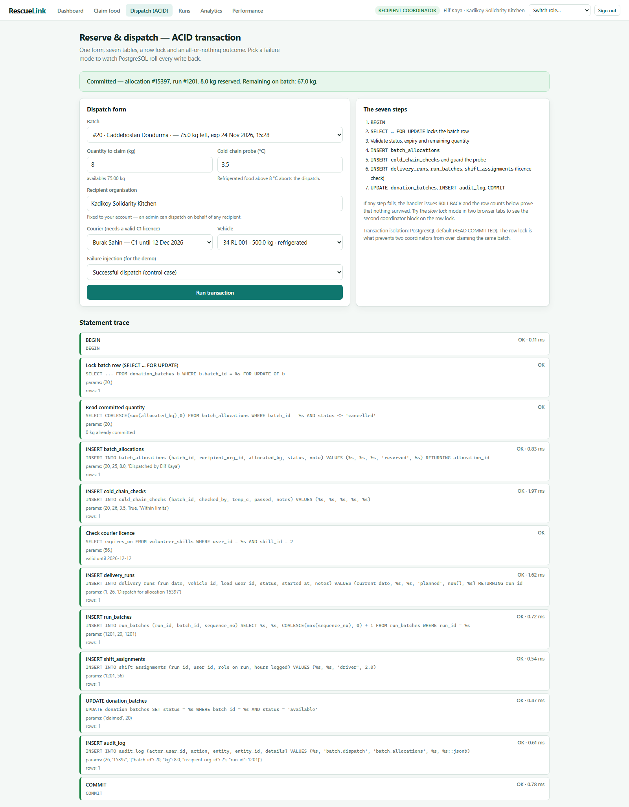

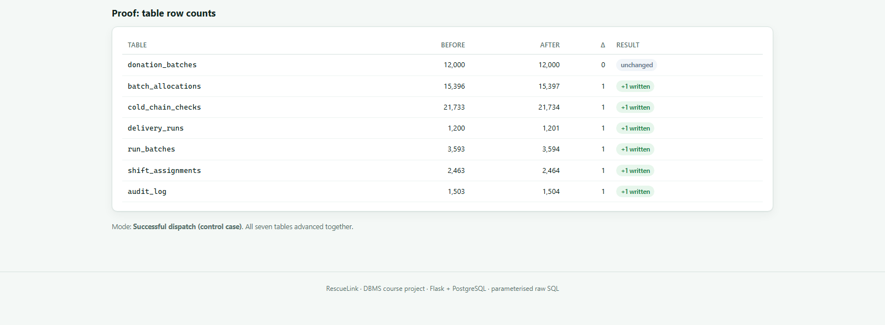

The failed run violates the status CHECK at the last step. The trace marks the
failed statement in red, shows the `ROLLBACK`, and every count returns to its
pre-transaction value:

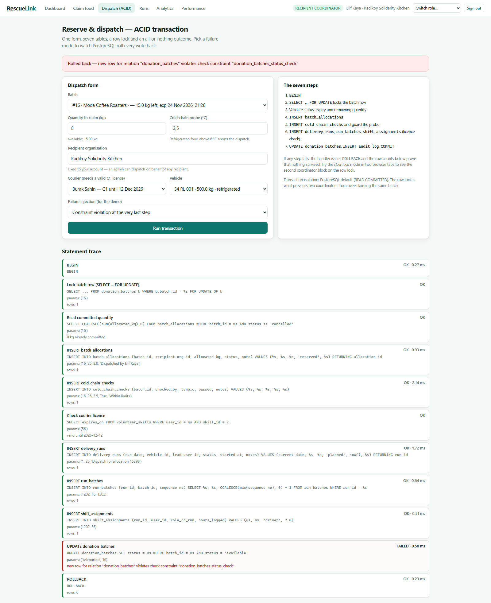

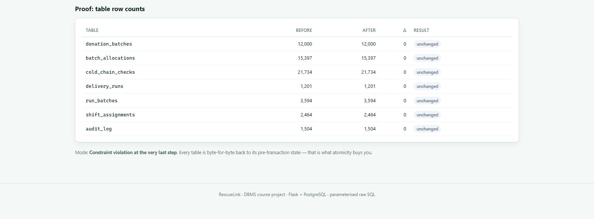

### 6.5 Concurrency and isolation

PostgreSQL's default isolation level is `READ COMMITTED`. Without a lock, two
coordinators could both read "50 kg remaining", both pass the guard, and both
insert. The row lock serialises them:

* coordinator A acquires the lock on the batch row;
* coordinator B blocks at `SELECT … FOR UPDATE`;
* A commits and changes `status` to `claimed`;
* B re-reads the updated row, sees a non-available status, and is rejected.

The `slow_lock` mode holds the lock for six seconds so this can be demonstrated
in two browser tabs during the presentation.

### 6.6 The same workflow in psql

`sql/05_transaction.sql` is a scripted version for the terminal. Scenario A
commits a real dispatch; Scenario B repeats every insert and then attempts
`UPDATE … SET status = 'teleported'`, which the CHECK constraint rejects:

```sql
BEGIN;
SELECT 'row locked' AS step, status
FROM donation_batches WHERE batch_id = :batch_id FOR UPDATE;

INSERT INTO batch_allocations (batch_id, recipient_org_id, allocated_kg, status)
VALUES (:batch_id, :recipient_id, 10, 'reserved');

INSERT INTO cold_chain_checks (batch_id, checked_by, temp_c, passed)
VALUES (:batch_id, :courier_id, 3.5, true);

INSERT INTO delivery_runs (run_date, vehicle_id, lead_user_id, status)
VALUES (current_date, :vehicle_id, :courier_id, 'planned');

-- ... shift and pickup inserts ...

UPDATE donation_batches SET status = 'teleported'   -- CHECK rejects this
WHERE batch_id = :batch_id;

ROLLBACK;
```

Running the file prints the counts before and after each scenario; Scenario B
leaves no allocation, run, shift or probe behind.

---

## 7. Non-trivial SQL query suite

The nine queries live in `sql/04_queries.sql` with machine-readable metadata
markers. The Flask analytics page parses **that same file**, so the SQL shown in
this report and the SQL executed by the application cannot drift. Full result
output is in `docs/query_output.txt`.

### 7.1 Technique coverage

| Query id | Title | Techniques |
| :--- | :--- | :--- |
| `donor_leaderboard` | Monthly rank and running total | `RANK()`, `SUM() OVER (PARTITION BY … ORDER BY …)` |
| `at_risk_pipeline` | At-risk batches matched to recipients | Three-stage CTE, `ROW_NUMBER()`, `LEFT JOIN` aggregation |
| `monthly_growth` | Month-over-month growth | CTE + `LAG()`, `NULLIF` division guard |
| `underserved_recipients` | Recipients below category average | Correlated subquery in `HAVING` |
| `dormant_donors` | Donors with no recent donation | Correlated `NOT EXISTS` anti-join |
| `fill_rate` | Share of each batch actually claimed | Subquery in `FROM`, filtered aggregate |
| `spoilage_by_category` | Spoilage above threshold | `GROUP BY … HAVING`, `COUNT(*) FILTER` |
| `volunteer_leaderboard` | Couriers with five completed runs | `GROUP BY … HAVING`, multi-table join |
| `top_donors_per_district` | Top two donors per district | `ROW_NUMBER() OVER (PARTITION BY …)` |

All four required families are present: **window functions** (Q1, Q2, Q3, Q9),
**CTEs** (Q1, Q2, Q3), **subqueries** (Q4 correlated, Q5 `NOT EXISTS`, Q6 in
`FROM`) and **`GROUP BY … HAVING`** (Q7, Q8).

### 7.2 Q1 — window functions: monthly rank and running total

```sql
WITH monthly AS (
    SELECT b.donor_org_id,
           o.name AS donor_name,
           date_trunc('month', b.created_at)::date AS month,
           sum(b.quantity_kg) AS rescued_kg,
           count(*)           AS batches
    FROM donation_batches b
    JOIN organizations o ON o.org_id = b.donor_org_id
    WHERE b.status IN ('delivered', 'claimed')
    GROUP BY b.donor_org_id, o.name, date_trunc('month', b.created_at)
)
SELECT month, donor_name, batches, rescued_kg,
       RANK() OVER (PARTITION BY month ORDER BY rescued_kg DESC) AS rank_in_month,
       round(sum(rescued_kg) OVER (PARTITION BY donor_org_id
                                   ORDER BY month), 1) AS running_total_kg
FROM monthly
WHERE month >= (date_trunc('month', current_date) - interval '3 months')
ORDER BY month DESC, rank_in_month
LIMIT 30;
```

The CTE collapses 12,000 batches to one row per donor-month. `RANK()` restarts
each month, while the running total accumulates **per donor** without a
self-join. Sample output (November 2026):

```
   month    |        donor_name         | batches | rescued_kg | rank_in_month | running_total_kg
------------+---------------------------+---------+------------+---------------+------------------
 2026-11-01 | Unlu Mamuller Kozyatagi   |      83 |    5450.00 |             1 |          21050.0
 2026-11-01 | Sodexo Corporate Kitchen  |      76 |    4660.00 |             2 |          24800.0
 2026-11-01 | Sutluce Catering          |      72 |    4440.00 |             3 |          24000.0
```

### 7.3 Q2 — multi-stage CTE: at-risk matching

This is the operations query. Stage 1 finds available batches expiring within
48 hours; stage 2 computes each recipient's rolling 7-day intake per category;
stage 3 joins recipient capabilities, keeps only those with spare weekly
capacity, and ranks the top three candidates per batch:

```sql
WITH at_risk AS (
    SELECT v.batch_id, v.category_id, v.donor_name, v.category_name,
           v.remaining_kg, v.expires_at, v.needs_refrigeration
    FROM v_batch_availability v
    WHERE v.status = 'available'
      AND v.remaining_kg > 0
      AND v.expires_at BETWEEN now() AND now() + interval '48 hours'
),
weekly_load AS (
    SELECT a.recipient_org_id, b.category_id, sum(a.allocated_kg) AS week_kg
    FROM batch_allocations a
    JOIN donation_batches b ON b.batch_id = a.batch_id
    WHERE a.status <> 'cancelled'
      AND a.allocated_at >= now() - interval '7 days'
    GROUP BY a.recipient_org_id, b.category_id
),
matches AS (
    SELECT ar.batch_id, ar.donor_name, ar.category_name, ar.remaining_kg,
           ar.expires_at, o.org_id AS recipient_org_id,
           o.name AS recipient_name, o.district,
           round(c.max_weekly_kg - COALESCE(w.week_kg, 0), 1) AS spare_weekly_kg,
           ROW_NUMBER() OVER (
               PARTITION BY ar.batch_id
               ORDER BY (c.max_weekly_kg - COALESCE(w.week_kg, 0)) DESC
           ) AS candidate_no
    FROM at_risk ar
    JOIN org_capabilities c ON c.category_id = ar.category_id
    JOIN organizations    o ON o.org_id = c.org_id AND o.is_active
    LEFT JOIN weekly_load w ON w.recipient_org_id = c.org_id
                           AND w.category_id = ar.category_id
    WHERE c.max_weekly_kg - COALESCE(w.week_kg, 0) >= LEAST(ar.remaining_kg, 20)
)
SELECT batch_id, donor_name, category_name, remaining_kg, expires_at,
       recipient_name, district, spare_weekly_kg, candidate_no
FROM matches
WHERE candidate_no <= 3
ORDER BY expires_at, batch_id, candidate_no;
```

The result is a dispatch shortlist (57 rows on the seeded data): each expiring
batch appears with up to three capable recipients and their remaining weekly
capacity.

### 7.4 Q8 — filtered aggregation: volunteer effort

```sql
SELECT u.full_name,
       count(*)                                         AS completed_runs,
       round(sum(s.hours_logged), 1)                    AS hours_logged,
       round(avg(s.hours_logged), 1)                    AS avg_hours_per_run,
       count(*) FILTER (WHERE s.role_on_run = 'driver') AS drives
FROM shift_assignments s
JOIN users         u ON u.user_id = s.user_id
JOIN delivery_runs r ON r.run_id = s.run_id
WHERE r.status = 'completed'
GROUP BY u.user_id, u.full_name
HAVING count(*) >= 5
ORDER BY hours_logged DESC;
```

The `WHERE` clause restricts to completed runs, so `count(*)` is already the
number of completed shifts; `HAVING` then filters the groups **after**
aggregation so volunteers with fewer than five completed runs never appear.
`FILTER` computes the driver-only count in the same pass. The top three on the
seeded data are Burak Simsek (98 runs, 344.5 h), Derya Yalcin (89, 341.0) and
Sibel Yildirim (89, 336.5).

### 7.5 What the other queries answer

* **Q3 `monthly_growth`** uses `LAG()` to compare each month with the previous
  and `NULLIF` to avoid division by zero; the first month correctly shows
  `NULL` growth.
* **Q4 `underserved_recipients`** places a correlated aggregate subquery in
  `HAVING`, comparing each recipient/category pair against the category-wide
  average; 49 pairs are below average.
* **Q5 `dormant_donors`** uses `NOT EXISTS` rather than `NOT IN` so a single
  `NULL` can never silently empty the retention list.
* **Q6 `fill_rate`** builds a per-batch fill percentage in a `FROM` subquery,
  then aggregates per category; average fill is ~80 % across categories.
* **Q7 `spoilage_by_category`** keeps categories with more than 6 % spoiled
  batches and at least 20 batches; all ten seeded categories exceed the 6 %
  threshold, led by Fresh Produce at 10.8 %.
* **Q9 `top_donors_per_district`** uses `ROW_NUMBER()` partitioned by district
  to return exactly two donors per district without a correlated top-N
  subquery.

---

## 8. Indexing and performance

### 8.1 Method

`sql/06_perf_test.py` is idempotent:

1. drop every `idx_*` index and run `ANALYZE` (the **before** state);
2. load `sql/02_indexes.sql`, run `ANALYZE` (the **after** state);
3. for each query, warm the cache once, then measure three
   `EXPLAIN (ANALYZE, BUFFERS, FORMAT JSON)` executions and keep the median;
4. write the human-readable plans to `docs/explain_before.txt` /
   `docs/explain_after.txt` and the summary to `docs/explain_summary.md`.

Using the median of three runs removes most cache and scheduler noise. The
dataset is fixed at 12,000 batches / ~15,400 allocations, so before and after
are directly comparable.

### 8.2 Indexes added

| Index | Definition | Serves |
| :--- | :--- | :--- |
| `idx_users_org` | `users (org_id)` | Staff lookup / RBAC scoping |
| `idx_capabilities_cat` | `org_capabilities (category_id)` | Category → recipients join |
| `idx_batches_donor_cover` | `donation_batches (donor_org_id, created_at DESC) INCLUDE (quantity_kg, category_id, status)` | Donor dashboard and leaderboards; covering so the heap is not touched |
| `idx_batches_available_exp` | `donation_batches (expires_at) WHERE status = 'available'` | Partial index for the expiry pool |
| `idx_batches_category` | `donation_batches (category_id)` | Category joins |
| `idx_alloc_batch` | `batch_allocations (batch_id)` | Availability view |
| `idx_alloc_recipient` | `batch_allocations (recipient_org_id, allocated_at DESC)` | Rolling 7-day intake, recipient claims |
| `idx_runs_date` | `delivery_runs (run_date DESC)` | Run list paging |
| `idx_shifts_user` | `shift_assignments (user_id)` | Courier dashboard |
| `idx_cold_checks_batch` | `cold_chain_checks (batch_id, checked_at DESC)` | Batch traceability |
| `idx_volskills_skill` | `volunteer_skills (skill_id)` | Licence eligibility |
| `idx_volskills_expiry` | `volunteer_skills (expires_on)` | Expiring certifications |
| `idx_audit_actor_time` | `audit_log (actor_user_id, created_at DESC)` | Audit paging |
| `idx_audit_entity` | `audit_log (entity, entity_id)` | Entity history |

Fourteen indexes in total, including one partial index and one covering index.

### 8.3 Before / after results

| Query | Before (ms) | After (ms) | Change |
| :---|---:|---:|---:|
| `at_risk_pipeline` | 4.51 | 1.83 | **−59 %** |
| `donor_leaderboard` | 7.42 | 7.66 | +3 % |
| `fill_rate` | 15.80 | 16.07 | +2 % |
| `dormant_donors` | 2.52 | 1.07 | **−58 %** |
| `top_donors_per_district` | 3.55 | 3.52 | −1 % |
| `app_donor_batches` (busiest page) | 0.53 | 0.04 | **−92 %** |
| `app_recipient_claims` | 0.59 | 0.15 | **−75 %** |

### 8.4 Plan evidence

Donor dashboard, **before** — full scan of 12,000 batches plus a hash join and
a top-N sort:

```
Limit  (actual time=0.542..0.547 rows=50)
  ->  Sort  (Sort Key: b.created_at DESC)  (top-N heapsort, 36kB)
        ->  Hash Join  (Hash Cond: b.category_id = c.category_id)
              ->  Seq Scan on donation_batches b
                    Filter: (donor_org_id = 7)
                    Rows Removed by Filter: 11510
```

**After** — the covering index returns the fifty newest rows already in order,
so the sort disappears:

```
Limit  (actual time=0.007..0.034 rows=50)
  ->  Nested Loop
        ->  Index Scan using idx_batches_donor_cover on donation_batches b
              Index Cond: (donor_org_id = 7)
        ->  Memoize  (48 hits, 2 misses)
              ->  Index Scan using food_categories_pkey on food_categories c
```

The at-risk pipeline keeps a sequential scan on `donation_batches` (48 hours is
not selective enough to justify an index), but replaces the scan of 15,000+
allocations with a bitmap index scan:

```
->  Bitmap Heap Scan on batch_allocations a   (rows=498)
      ->  Bitmap Index Scan on idx_alloc_recipient
            Index Cond: (allocated_at >= now() - '7 days'::interval)
```

### 8.5 Discussion

The measurements are reported honestly, including the queries that did **not**
improve:

* The four selective queries gain 58–92 %. The wins come from matching the
  index to the access path, not from adding indexes indiscriminately.
* `donor_leaderboard` and `fill_rate` aggregate **every** row. PostgreSQL
  correctly keeps the sequential scan; an index would add random I/O without
  reducing work. Their +2–3 % movement is run-to-run noise.
* `top_donors_per_district` scans the whole table for the same reason and
  remains essentially flat (−1 %).
* The remaining ~0.15 ms for recipient claims is index access to a handful of
  rows; further indexing would not be measurable at this scale.

This is the practical lesson of the exercise: an index is an optimisation only
when it changes the plan for a selective predicate.

---

## 9. Web application

### 9.1 Architecture

```
Browser (plain HTML forms)
        │
        ▼
Flask routes (app/app.py)  ── RBAC decorators (app/auth.py)
        │                         └── per-request user from session
        ▼
db.py  (psycopg, dict rows, one connection per request, autocommit off)
        │
        ├── dispatch.py   dedicated autocommit connection for BEGIN/COMMIT/ROLLBACK
        ├── sql_loader.py parses sql/04_queries.sql for the analytics page
        ▼
PostgreSQL 18.6  (rescuelink @ 127.0.0.1:5433)
```

There is no ORM and no query builder. Reads use `query()` / `query_one()`,
single writes use `execute()` (commit), and the multi-step workflow uses
`dispatch.py` so the transaction boundaries are explicit.

### 9.2 Screens

**Login and role switching.** Four one-click demo accounts plus a normal
e-mail/password form. The session stores only `user_id`; the role is re-read
from the database on every request, so disabling a user takes effect
immediately.

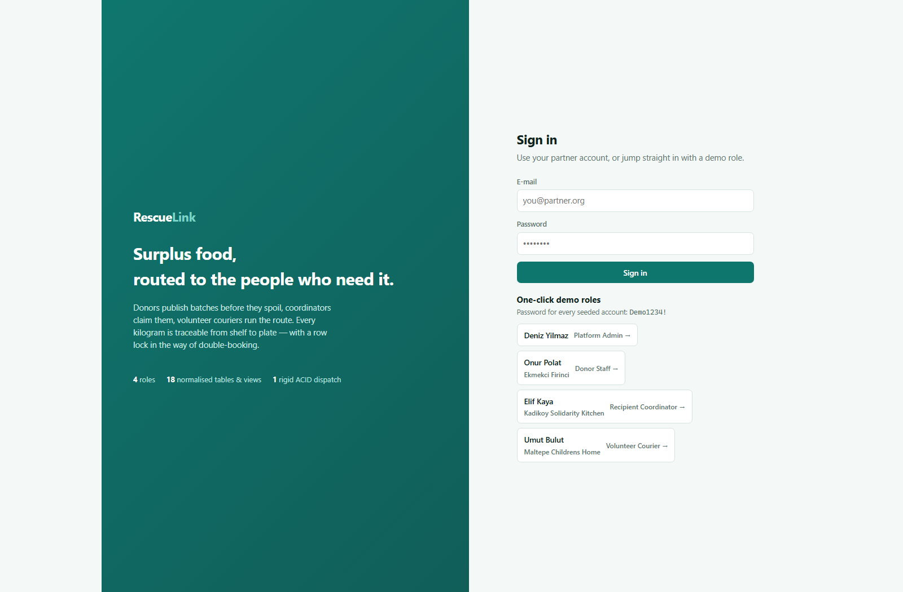

**Admin dashboard.** Platform KPIs (batches, rescued kg, at-risk count,
cold-chain failures, partner counts) and the latest audit activity.

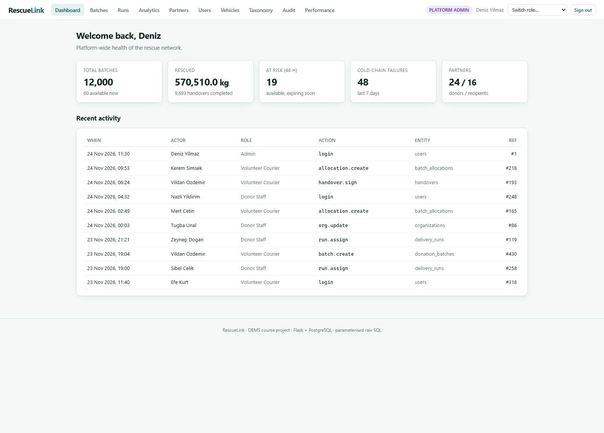

**CRUD — partner organisations.** Create, edit and delete organisations, with
unique tax id and e-mail validation surfaced as flash messages rather than a
stack trace.

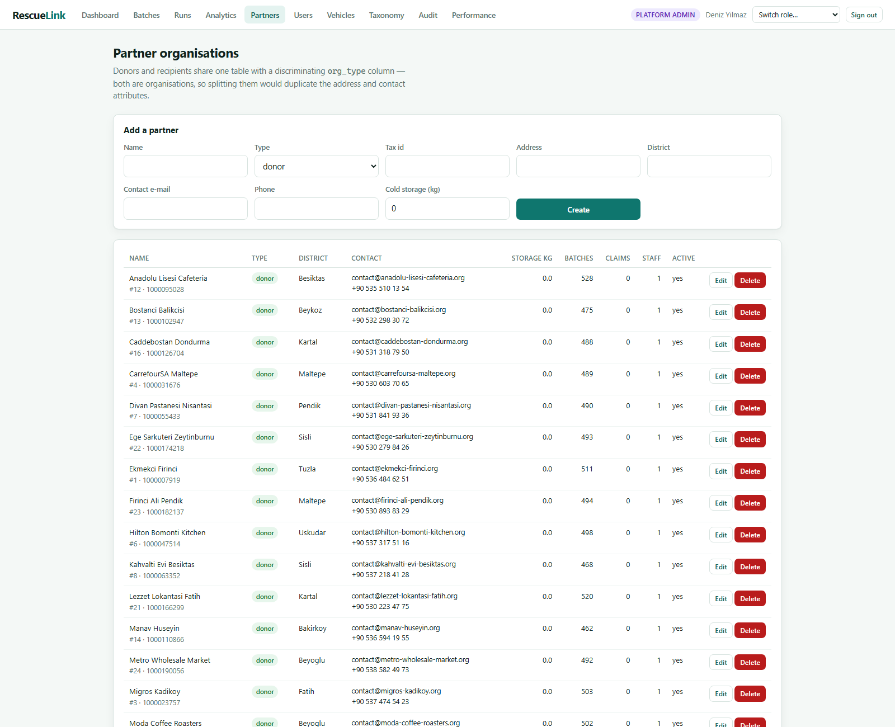

**CRUD — donor batches.** The donor sees only their own organisation's batches,
with derived remaining kg and a soft-delete "Withdraw" action. Withdrawal sets
`status = 'withdrawn'` instead of deleting, preserving the audit trail and any
claims already made against the batch.

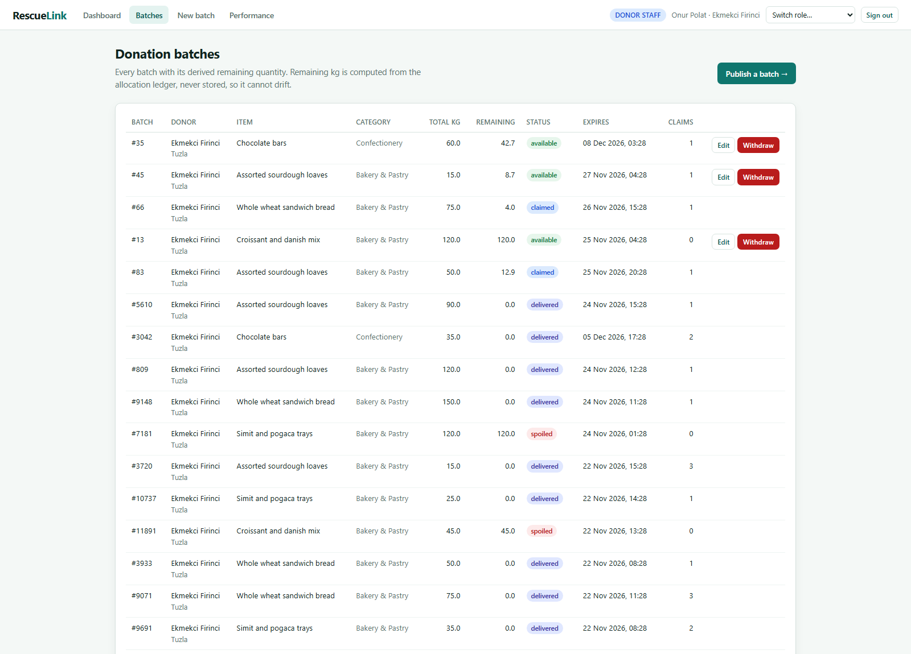

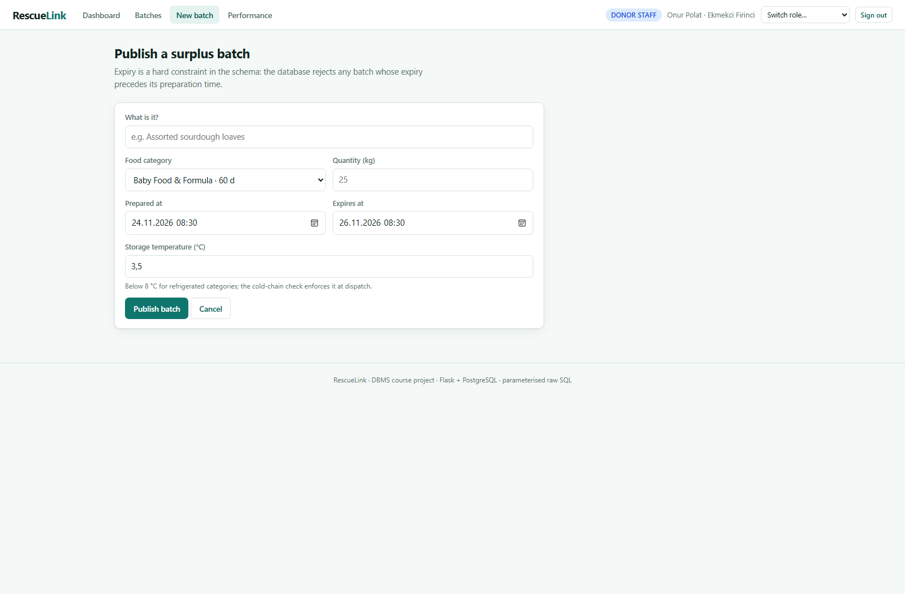

**Recipient claims.** Only batches whose category is inside the organisation's
declared capabilities are listed; the join against `org_capabilities` happens
in SQL, not in the template. Signing a handover is a second multi-table
transaction: it inserts the receipt, flips the allocation, closes the batch
when no reservations remain, and writes an audit row.

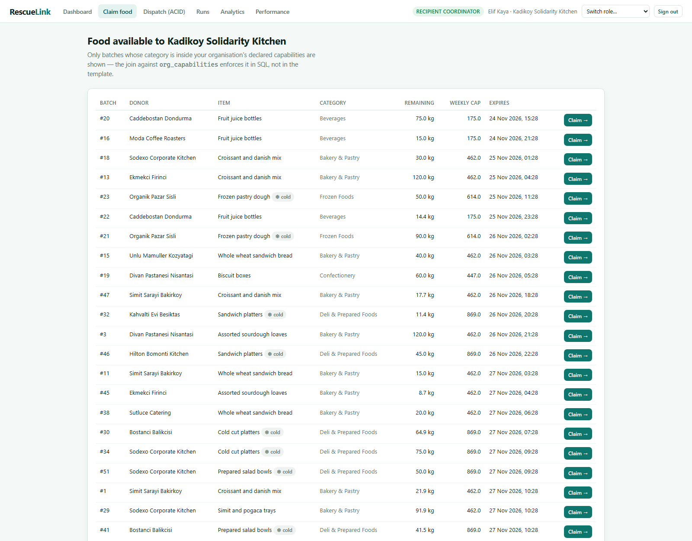

**Transaction demo.** The form, the seven documented steps and the failure
injector:

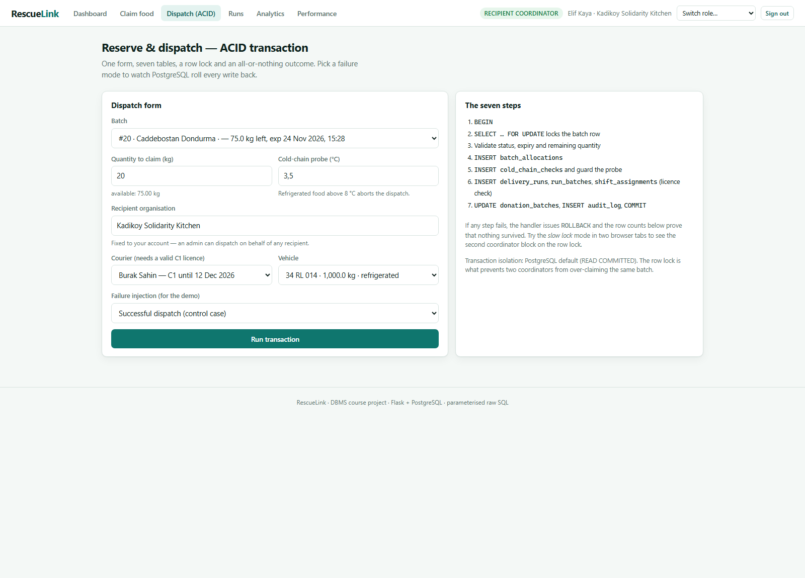

**Delivery runs.** `v_run_summary` supplies batch count, crew size and carried
kg without join fan-out; the detail page exposes the pickup sequence and crew.

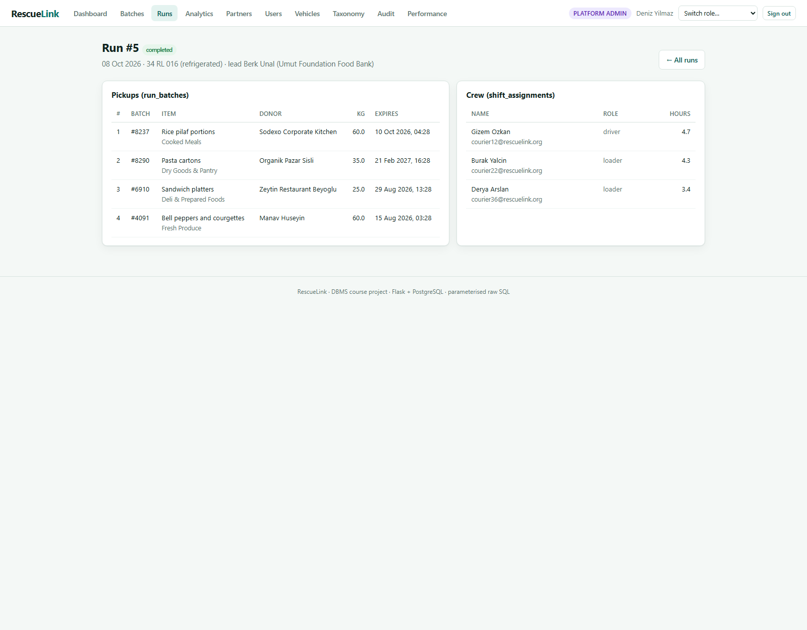

**Analytics.** All nine queries, each with its technique label, execution time,
row count and collapsible SQL. The page is generated from
`sql/04_queries.sql`, so it is a live demonstration of the report's SQL.

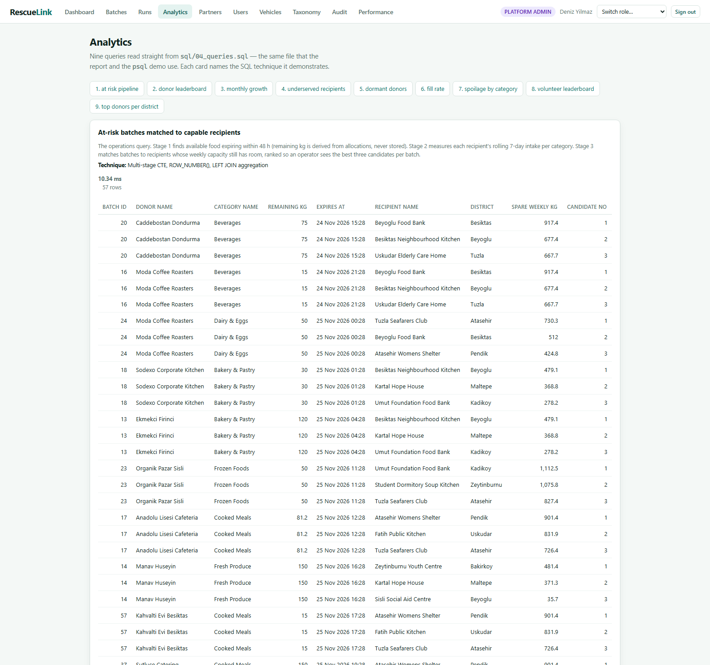

**Performance.** The generated `explain_summary.md` plus the full before/after
plans, with reproduction commands.

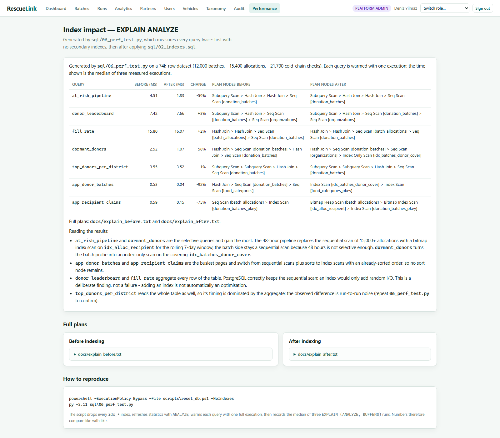

**Audit trail.** Actor, role, action, entity and JSON details for every
privileged write.

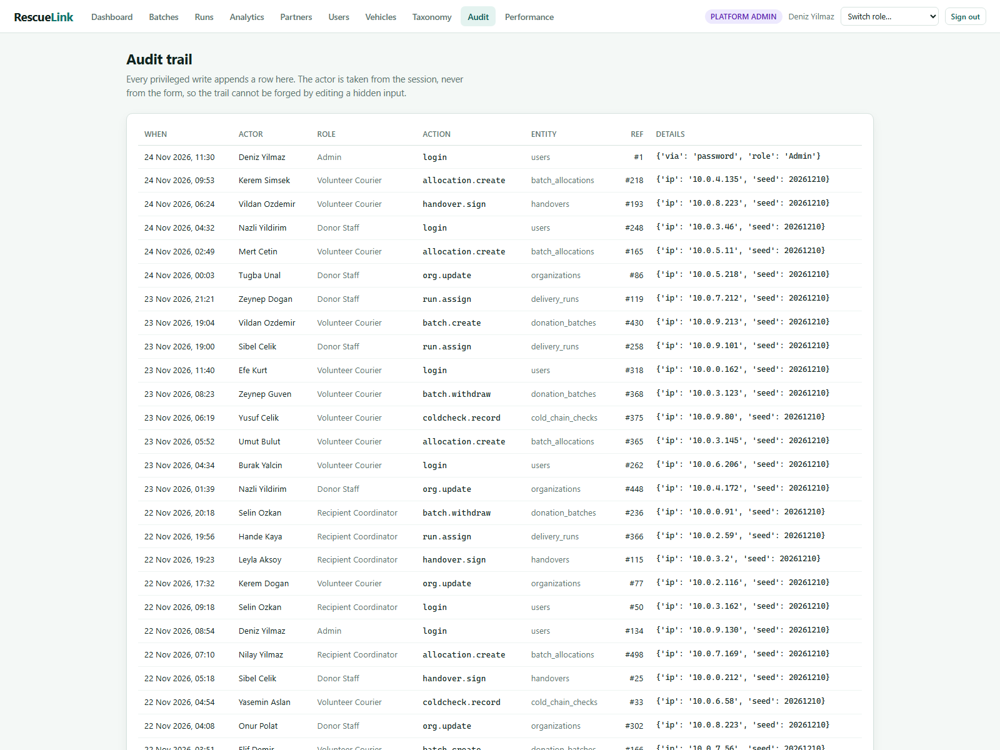

### 9.3 SQL injection defence

Every user-supplied value is passed as a bound parameter; the driver sends the
SQL text and values separately. A typical write:

```python
db.execute("""
    INSERT INTO organizations
        (name, org_type, tax_id, address, district,
         contact_email, phone, cold_storage_kg)
    VALUES (%s, %s, %s, %s, %s, %s, %s, %s)
""", (name, org_type, tax_id, address, district,
      contact_email, phone, cold_storage_kg))
```

There are exactly two deliberate exceptions, both safe:

1. The analytics suite is read-only SQL loaded from a file shipped with the
   application; it takes no user input and is executed without parameters.
2. The transaction's row-count proof interpolates a table name from a
   module-level tuple (`AFFECTED_TABLES`), not from the request.

No route builds SQL by concatenating a form value. `ORDER BY` clauses are
static; filters are expressed as `(%s::int IS NULL OR column = %s)`, which
keeps one prepared statement per page.

### 9.4 Error handling and audit

* Business-rule rejections are flash messages or a rollback banner, with the
  database's own error text.
* Constraint violations (duplicate tax id, duplicate plate) are caught and
  shown as "already exists", not as a 500.
* `403` and `404` render a friendly error page.
* Every create/update/withdraw/dispatch/handover appends to `audit_log` with
  the session actor and a JSON payload.

---

## 10. Verification and reproducibility

### 10.1 Automated smoke test

`scripts/smoke_test.py` drives the real Flask app with its test client and the
real database. It asserts **50 checks**, all passing:

| Area | Checks |
| :--- | :--- |
| Public surface | anonymous redirect, login page renders |
| Admin | login; 11 pages render; create/delete organisation; duplicate tax id rejected |
| Donor | login; 3 pages render; RBAC denies analytics and transaction; create, update, withdraw a batch; withdrawn batch remains visible |
| Coordinator + transaction | login; claims page; commit writes allocation, run, shift, audit; batch status flips; over-allocation, cold-chain, late failure, expiry and uncertified courier all roll back with **zero** row-count change |
| Handover | commit flips allocation and inserts receipt; double handover rejected |
| Analytics | 9 result cards rendered |
| Courier | login; dashboard and runs render; batches, audit and admin pages denied (403) |

Run it with the database up and seeded:

```powershell
py -3.11 scripts\smoke_test.py
# 50 passed, 0 failed of 50
```

### 10.2 From an empty machine

```powershell
# 1. create the project-local PostgreSQL cluster (port 5433)
powershell -ExecutionPolicy Bypass -File scripts\init_cluster.ps1

# 2. schema -> deterministic seed -> indexes
powershell -ExecutionPolicy Bypass -File scripts\reset_db.ps1

# 3. run the tests
py -3.11 scripts\smoke_test.py

# 4. start the web application
cd app
py -3.11 app.py            # http://127.0.0.1:5000
```

To reproduce the performance numbers:

```powershell
powershell -ExecutionPolicy Bypass -File scripts\reset_db.ps1 -NoIndexes
py -3.11 sql\06_perf_test.py     # measures before, applies indexes, measures after
```

The script writes the plans and the summary table into `docs/`. The
`/performance` page reads those artefacts, so the app and the report always
show the same measurement.

### 10.3 Docker alternative

`docker-compose.yml` starts PostgreSQL 16 and the Flask app, mounts the schema,
seed and index files, and exposes the same port. The scripts above remain the
primary, verified path; the compose file exists so the project can be rebuilt
on a machine without a local PostgreSQL installation.

### 10.4 Repository map

| Path | Contents |
| :--- | :--- |
| `sql/01_schema.sql` | 16 tables, constraints, two views |
| `sql/02_indexes.sql` | 14 secondary indexes (the "after" state) |
| `sql/03_seed.py` | deterministic 73,645-row seeder |
| `sql/04_queries.sql` | 9 analytical queries + metadata |
| `sql/05_transaction.sql` | psql commit/rollback demonstration |
| `sql/06_perf_test.py` | EXPLAIN benchmark, writes `docs/explain_*.txt` |
| `app/app.py` | all Flask routes |
| `app/auth.py` | RBAC decorators and session user |
| `app/dispatch.py` | the seven-table ACID transaction and trace |
| `app/db.py` | thin psycopg access layer |
| `app/templates/` | Jinja templates for every screen |
| `scripts/` | cluster, reset, smoke test, screenshots, PDF build |
| `docs/proposal.md` | one-page proposal |
| `docs/report.md` | this report |
| `docs/query_output.txt` | raw output of the nine queries |
| `docs/explain_before.txt` / `_after.txt` | full EXPLAIN plans |
| `docs/screenshots/` | 15 live screenshots used above |

---

## 11. Limitations and future work

* **Single-node PostgreSQL.** The transaction demonstrates row-level locking,
  but not distributed consensus. A production deployment would add a replica
  and connection pooling (PgBouncer).
* **No password reset or e-mail verification.** Demo accounts are seeded; the
  authentication layer is intentionally minimal and uses Werkzeug's password
  hashing.
* **Derived remaining kg is recomputed per query.** This is fast at 12,000
  batches (1.8 ms) but would need a materialized view or a ledger trigger at
  millions of rows. The trade-off is documented rather than hidden.
* **No geospatial routing.** Districts are text; a real deployment would use
  PostGIS and optimise pickup order.
* **Audit log is append-only by convention.** A production system would revoke
  `UPDATE`/`DELETE` on `audit_log` from the application role.
* **Timezone display** is UTC in the database and formatted for the user; a
  full localisation layer is out of scope.

---

## 12. Requirements checklist

| Requirement | Where | Status |
|---|---|:---:|
| At least 8 meaningful tables | 16 tables (§2.2) | ✓ |
| At least 2 M:N relationships | 5 junction tables (§2.4) | ✓ |
| At least 3 user roles | 4 roles, RBAC matrix (§4) | ✓ |
| One multi-step ACID transaction with COMMIT/ROLLBACK | 7-table dispatch (§6), psql script | ✓ |
| 3NF, denormalization documented | §3, explicit no-cache decision | ✓ |
| Seed several hundred realistic rows | 73,645 deterministic rows (§5) | ✓ |
| EXPLAIN ANALYZE before/after indexes, gains documented | 14 indexes, 7 queries (§8) | ✓ |
| Window functions | Q1 `RANK`/`SUM OVER`, Q2 `ROW_NUMBER`, Q3 `LAG`, Q9 `ROW_NUMBER` | ✓ |
| CTEs | Q1, Q2, Q3 | ✓ |
| Subqueries | Q4 correlated, Q5 `NOT EXISTS`, Q6 in `FROM` | ✓ |
| `GROUP BY … HAVING` | Q7, Q8 | ✓ |
| Plain HTML front end + lightweight backend | Flask + Jinja + one CSS file | ✓ |
| Parameterized raw SQL, no ORM | §9.3, `app/db.py` | ✓ |
| Role switcher / login with RBAC | login page + `/switch`, §4 | ✓ |
| CRUD views | batches, organisations, categories, users, vehicles | ✓ |
| Transaction demo form | `/transaction`, 7 failure modes | ✓ |
| Analytics page | `/analytics`, 9 queries from the SQL file | ✓ |
| Report with code snippets and output screenshots | this document | ✓ |

---

## Appendix A — Selected constraint definitions

```sql
-- A batch can never expire before it was prepared.
CONSTRAINT batch_expiry_after_preparation CHECK (expires_at > prepared_at)

-- Partner staff must belong to an organisation; admins need not.
CONSTRAINT users_org_required_for_partners
    CHECK ( (role_id = 1) OR (org_id IS NOT NULL) )

-- A run cannot be completed before it started.
CONSTRAINT run_time_order
    CHECK (completed_at IS NULL OR started_at IS NULL
           OR completed_at >= started_at)

-- Exactly one signed receipt per allocation.
allocation_id integer NOT NULL UNIQUE
    REFERENCES batch_allocations (allocation_id) ON DELETE CASCADE

-- One crew row per volunteer per run, with a bounded shift length.
PRIMARY KEY (run_id, user_id),
hours_logged numeric(4,1) NOT NULL DEFAULT 0
    CHECK (hours_logged BETWEEN 0 AND 24)
```

## Appendix B — Query output

The complete result sets of all nine queries are saved in
`docs/query_output.txt` (generated with `psql -f sql/04_queries.sql`). The full
`EXPLAIN (ANALYZE, BUFFERS)` plans are in `docs/explain_before.txt` and
`docs/explain_after.txt`.

---

*End of report.*
